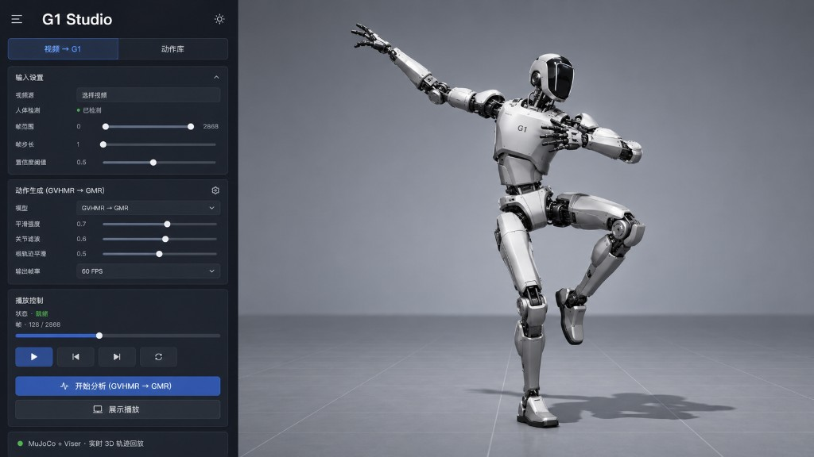
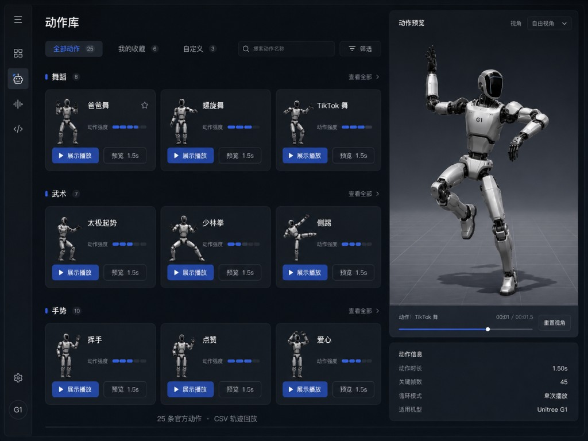
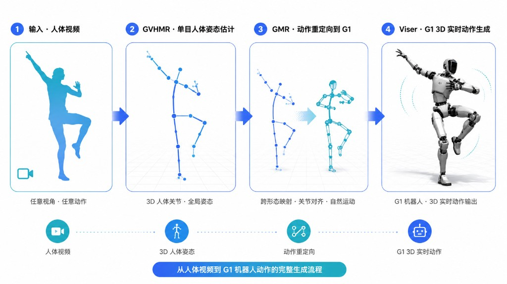
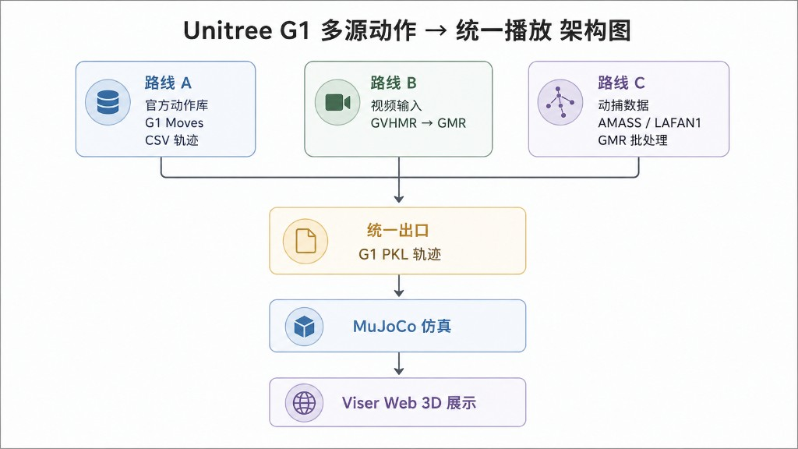
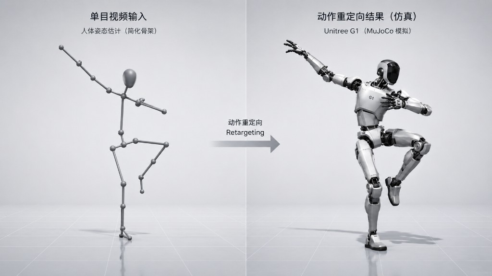

# Unitree-G1MuJoCo-Viser

面向 **Unitree G1** 人形机器人的动作展示与「人体动作 → 机器人动作」转换系统。  
在浏览器中通过 **Viser** 实时查看 MuJoCo 驱动的 G1 三维姿态（**不是**播放 mp4 视频），并支持官方动作库、视频重定向与动捕批处理三条输入路线。

<p align="center">
  
  <br/>
  <sub>G1 Studio · 视频→G1 工作台：上传人体视频 → GVHMR→GMR 分析 → 浏览器 3D 实时回放</sub>
</p>

---

## 效果展示

| 动作库 | 视频→G1 四步流程 | 多源统一架构 | 动作重定向 |
|:---:|:---:|:---:|:---:|
|  |  |  |  |
| 25 条官方动作分类浏览与播放 | 人体视频 → GVHMR → GMR → Viser | 三条路线汇入统一 PKL 后 3D 展示 | 人体骨架映射到 G1（MuJoCo 仿真） |

---

## 系统做什么

本系统解决一个问题：**如何把不同来源的「人的动作」变成 G1 机器人可以在浏览器里看到的动作**。

- **展示层**：MuJoCo 更新机器人关节状态，Viser 同步到 Web 3D 视口，支持暂停、变速、循环与动作切换平滑过渡  
- **输入层**：支持三类来源，最终统一为 G1 轨迹格式（PKL：帧率、根部位姿、关节角）  
- **扩展层**：对齐 G1 Moves ONNX 160 维观测空间，便于后续接入闭环控制  

---

## 系统架构（三条路线 · 一个出口）

<p align="center">
  
</p>

```
┌──────────────────────────────────────────────────────────────────┐
│                         三条输入路线                               │
├─────────────────┬──────────────────────┬─────────────────────────┤
│  路线 A          │  路线 B               │  路线 C                  │
│  G1 Moves 官方库 │  人体视频 / AIST++    │  AMASS / LAFAN1          │
│  CSV 轨迹        │                      │  动捕数据（SMPL-X / BVH） │
└────────┬────────┴──────────┬───────────┴────────────┬────────────┘
         │                   │                        │
         │ 直接加载           ▼                        ▼
         │            GVHMR（视频估人体）        GMR 批处理
         │                   │                        │
         │                   ▼                        │
         │               GMR（转 G1）◄─────────────────┘
         │                   │
         └───────────────────┼────────────────────────────
                             ▼
                  统一出口 · G1 PKL 轨迹
                             ▼
                      MuJoCo 仿真
                             ▼
                   Viser Web 3D 展示
```

### 三条路线区别（重要）

| 路线 | 输入 | 处理流程 | 说明 |
|------|------|----------|------|
| **A · 官方库** | G1 Moves 25 条展示动作 | CSV → 直接 Viser 播放 | **不经过** GVHMR / GMR |
| **B · 视频** | 用户上传 mp4、AIST++ 样例 | 视频 → **GVHMR** → **GMR** → PKL → Viser | 人体视频转 G1 同款动作 |
| **C · 动捕** | AMASS、LAFAN1 等 | 动捕数据 → **GMR 批处理** → PKL → Viser | **不经过** GVHMR |

三条路线最终输出格式一致，因此共用同一套 Viser 播放逻辑。

---

## 视频 → G1 流程（路线 B 详解）

<p align="center">
  
</p>

```
① 输入 · 人体视频
        ↓
② GVHMR · 单目人体姿态估计（从视频恢复 3D 人体运动）
        ↓
③ GMR · 动作重定向到 G1（跨形态映射，输出 G1 PKL 轨迹）
        ↓
④ Viser · G1 三维实时动作展示（浏览器中看 G1 跳同款动作）
```

<p align="center">
  
  <br/>
  <sub>动作重定向：人体骨架姿态 → 映射 → Unitree G1（MuJoCo 仿真验证）</sub>
</p>

---

## Viser 界面

系统侧边栏分为两个工作区：

| Tab | 功能 |
|-----|------|
| **视频 → G1** | 上传视频 / 选择 AIST++ 样例 → 一键 GVHMR→GMR 分析 → 3D 播放 |
| **动作库** | 官方 25 动作（舞蹈 / 武术 / 手势）+ 生成动作库（按来源分组） |

<p align="center">
  
  <br/>
  <sub>动作库：分类浏览、强度展示、展示播放与短预览</sub>
</p>

---

## 快速开始

### 环境要求

- Python 3.10+
- [MuJoCo](https://mujoco.org/)
- [Viser](https://github.com/nerfstudio-project/viser)
- NumPy

### 安装与运行

```bash
git clone https://github.com/02xiao/Unitree-G1MuJoCo-Viser.git
cd Unitree-G1MuJoCo-Viser

pip install mujoco viser numpy

python main.py --port 9878
```

浏览器访问 `http://localhost:9878`，在侧边栏选择动作或进入「视频→G1」工作台。

> **动作数据**：仓库已包含 `web_csv` 演示轨迹。Policy ONNX / retarget PKL 体积较大，可通过 `g1_moves/g1_moves_scripts/download_g1moves_selected.py` 从 [G1 Moves](https://huggingface.co/datasets/exptech/g1-moves) 按需下载。

### 视频 → G1（可选）

完整视频分析需自行部署外部工具链：

1. [GVHMR](https://github.com/zju3dv/GVHMR) — 单目视频人体运动恢复  
2. [GMR](https://github.com/YanjieZe/GMR) — 人体动作重定向到 G1  

复制配置模板并填写本地仓库路径后即可启用一键分析。  
**未配置时**：官方动作库与手动 PKL 加载仍可正常使用。

### 自检

```bash
python main.py --registry
python main.py --dry-run-batch amass
python gvhmr_gmr/scripts/validate_integration.py
```

---

## 技术栈

| 类别 | 技术 |
|------|------|
| 仿真 | MuJoCo |
| Web 3D | Viser |
| 机器人 | Unitree G1 |
| 视频人体估计 | GVHMR |
| 动作重定向 | GMR |
| 策略接口 | G1 Moves ONNX（obs160） |

---

## 说明

- Web 展示当前为 **kinematic 轨迹回放**，保证 Viser 端稳定可视；ONNX 闭环动力学需匹配训练仿真环境  
- 视频 / 动捕数据需用户自行获取并遵守各数据集许可  
- 本地配置与生成产物不纳入公开仓库  

---

## 参考

- [G1 Moves Dataset](https://huggingface.co/datasets/exptech/g1-moves)
- [GVHMR](https://github.com/zju3dv/GVHMR)
- [GMR](https://github.com/YanjieZe/GMR)
- [Viser](https://github.com/nerfstudio-project/viser)
- [MuJoCo](https://mujoco.org/)

---

## License

本项目代码仅供学习与研究。G1 模型 mesh、G1 Moves 数据及外部工具链请遵循各自原始仓库与数据集许可。
